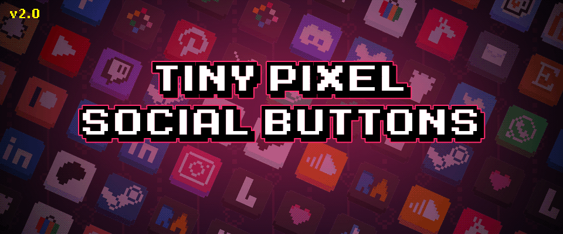
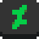
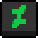
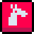

# Tiny Pixel Social Buttons: Hosted Set

[](https://github.com/IanSkelskey/tiny-pixel-social-buttons/actions/workflows/deploy.yml)

Eight buttons from **[Tiny Pixel Social Buttons](https://ianskelskey.itch.io/tiny-pixel-social-buttons)**, the ones I use across my own sites. They're published on GitHub Pages, so every site links to the same files and picks up changes as soon as I update them here.

<p align="center">
  &nbsp;
  &nbsp;
  &nbsp;
  &nbsp;
  &nbsp;
  &nbsp;
  &nbsp;
  
</p>
<p align="center">
  &nbsp;
  &nbsp;
  &nbsp;
  &nbsp;
  &nbsp;
  &nbsp;
  &nbsp;
  
</p>

Every button has **normal**, **hover** and **pressed** states, in the original style and the **outlined** one. GitHub can't show hover here; try them on the **[live demo](https://ianskelskey.github.io/tiny-pixel-social-buttons/)**.

## Using them

Everything is served from:

```
https://ianskelskey.github.io/tiny-pixel-social-buttons/
```

Use these Pages URLs rather than `raw.githubusercontent.com`. Pages is built for serving files to other sites; raw links are for reading the repository.

### On a website, with hover and pressed

Link the stylesheet once, then give each link two classes:

```html
<link rel="stylesheet" href="https://ianskelskey.github.io/tiny-pixel-social-buttons/tiny-socials.css">

<a class="tps tps-github" href="https://github.com/IanSkelskey" aria-label="GitHub"></a>
<a class="tps tps-outlined tps-lospec" href="https://lospec.com/ianskelskey" aria-label="Lospec"></a>
```

- **Hover and pressed** come from `:hover` and `:active`; keyboard focus shows the hover state too.
- **Outlined style:** add `tps-outlined`.
- **Size:** 48px by default. Change it with `--tps-size`, in multiples of 16px so the pixels stay square:

  ```html
  <a class="tps tps-itch" style="--tps-size: 32px" href="https://ianskelskey.itch.io" aria-label="itch.io"></a>
  ```

  Or for every button on a page: `.tps { --tps-size: 64px; }`.

Each button is one image with its three states stacked, so hover and pressed are already loaded and nothing flickers.

The class names are the icon names: `tps-github`, `tps-linkedin`, `tps-deviantart`, `tps-youtube`, `tps-instagram`, `tps-itch`, `tps-lexaloffle`, `tps-lospec`.

### As a plain image

Where you can't add CSS, link a single state directly:

```html
<a href="https://github.com/IanSkelskey">
  
</a>
```

### In Markdown (GitHub, itch.io)

```markdown
[](https://github.com/IanSkelskey)
```

## Files

| Path                           | What it is                                                   |
| ------------------------------ | ------------------------------------------------------------ |
| `tiny-socials.css`             | The stylesheet for hover/pressed buttons                     |
| `images/sprites/<name>.png`    | 16x48: normal, hover and pressed stacked (used by the CSS)   |
| `images/x1/<state>/<name>.png` | 16x16 originals; `<state>` is `normal`, `hover` or `pressed` |
| `images/x3/<state>/<name>.png` | 48x48, scaled nearest-neighbour so they stay crisp           |
| `images/outlined/…`            | Everything under `images/` again, in the outlined style      |
| `index.html`                   | The live demo                                                |

Every push to `main` redeploys the site through [`.github/workflows/deploy.yml`](.github/workflows/deploy.yml).

## Want the rest?

The full pack has 30 icons, with tile sheets for engines and sprite sheets of every state.

**[Get Tiny Pixel Social Buttons on itch.io →](https://ianskelskey.itch.io/tiny-pixel-social-buttons)**

## License

Free to use for linking to your own profiles, on sites, in READMEs and in comments. Credit is appreciated: **Tiny Pixel Social Buttons by Ian Skelskey**.

Please don't redistribute them as an icon pack of your own.

These are unofficial, fan-made icons, not affiliated with or endorsed by the platforms they represent.

Hand-drawn, no AI.
